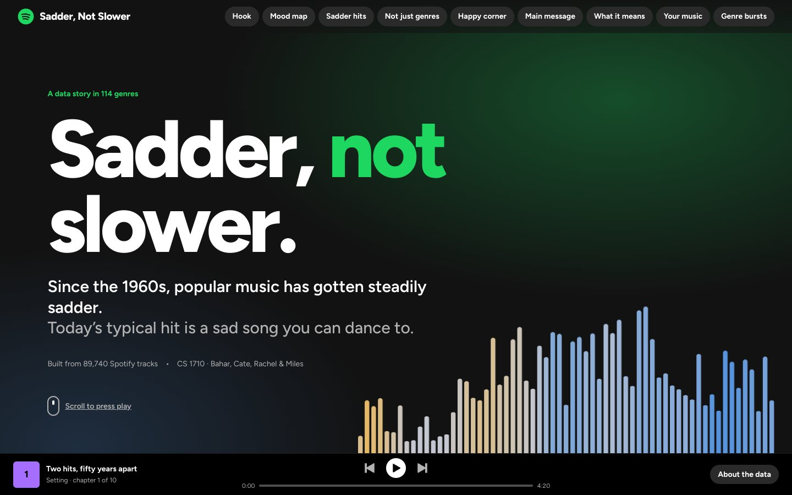

# Sadder, Not Slower

**CS 1710 final project, Prototype V1.** An interactive, scroll-driven data story about how the mood of popular music changed:

> Since the 1960s, popular music has gotten steadily sadder, but not slower. Today's typical hit is a sad song you can dance to.

Built from 114,000 Spotify tracks (114 genres) with release dates and artist gender added by our team.
Team: Bahar Moradi, Cate Buchan, Rachel Richey, Miles Schwab.



## Run it

You need [Node 18+](https://nodejs.org). In the project folder:

```bash
npm install
npm run dev        # http://localhost:5173, hot reload
npm test           # data checks + full-page render + interaction tests
npm run build      # production build into dist/
npm run preview    # serve the production build locally
```

The processed data already lives in `public/data/`, so the site runs without Python.
You only need Python to *rebuild* the data (see below).

## The story (storyboard to code)

| # | Chapter | Storyboard frame | Component |
|---|---------|------------------|-----------|
| 1 | Two hits, fifty years apart | Hook | `charts/SongCards.jsx` |
| 2 | How do you measure a song's mood? | Background and problem (sketch 10) | `charts/MoodMap.jsx` |
| 3 | Hits got sadder, decade by decade | Rising insight 1 | `charts/SadShareLine.jsx` |
| 4 | It's not just which genres got popular | Rising insight 2 | `charts/GenreDumbbell.jsx` |
| 5 | The happy corner is emptying out | Opportunity | `charts/MoodTimeMap.jsx` |
| 6 | Today's hit is a sad song you can dance to | Main message (sketch 7) | `charts/HitRadar.jsx` |
| 7 | What this means | Recommendations | `charts/TakeawayCards.jsx` |
| 8 | Where does your music land? | Call to action | `charts/SongFinder.jsx` |
| 9 | What does each genre sound like? | Novel view (sketch 11) | `charts/GenreBurst.jsx` |
| 10 | Behind the data | Method | `sections/DataSection.jsx` |

Chapter text and scroll steps live in `src/sections/StorySections.jsx`. Every number in the text is computed from the data, never typed in.

## Data pipeline

```
data/raw/spotify_tracks_with_dates_gender.csv      (not in git, ~50 MB)
        |  pipeline/clean_data.py
        v
data/processed/tracks_clean.csv                    (not in git)
        |  pipeline/build_story_data.py
        v
public/data/*.json                                 (in git, ~4 MB)
        |  fetch() in src/lib/data.js
        v
React + D3 charts
```

To rebuild the data:

```bash
pip install -r pipeline/requirements.txt
# put the raw CSV in data/raw/ (ask the team for the shared copy)
npm run data
npm test            # fails loudly if a headline number drifted from the process book
```

Details, definitions and known problems: [docs/DATA_PIPELINE.md](docs/DATA_PIPELINE.md).

## Project layout

```
pipeline/            Python: clean + aggregate the data
public/data/         JSON the site loads (generated, committed so the site just runs)
src/
  App.jsx            loads all data, lays out the chapters
  chapters.js        chapter ids, titles, colours (nav + player bar read this)
  components/        Scrolly (sticky chart + steps), Chapter, Nav, PlayerBar, Tooltip
  charts/            one file per visualization
  sections/          Hero, chapter text, data section
  lib/               data loading, hooks, formatting + colour scales
  styles/            global.css (design tokens), charts.css
  __tests__/         vitest
docs/                pipeline notes, contributing guide, process-book notes, screenshots
```

## Deploy

**GitHub Pages (automatic):** push to `main`, then in the repo go to *Settings > Pages* and set *Source* to **GitHub Actions**.
The workflow in `.github/workflows/deploy.yml` tests, builds and publishes. (We have not run this workflow yet. If it fails, open the Actions tab and read the log.)

**Anywhere else:** `npm run build`, then upload the `dist/` folder to Netlify Drop, Vercel, or any static host. Paths are relative, so it works from a sub-folder too.

## Contributing

See [docs/CONTRIBUTING.md](docs/CONTRIBUTING.md).
